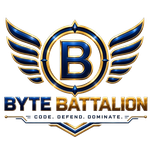
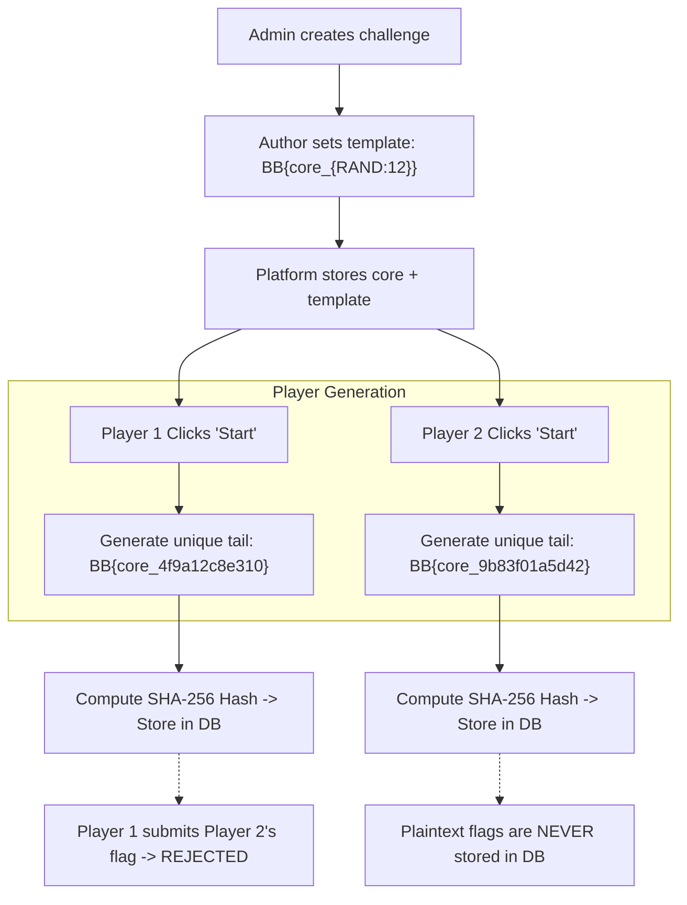

<div align="center">



# BYTE_BATALLION CTF PLATFORM

**Next-Generation Self-Hosted Cybersecurity Competition Platform**

[](https://github.com/purnendu-rai/ByteBatallion-CTF-Platform)
[](https://www.python.org/)
[](https://fastapi.tiangolo.com/)
[](https://www.sqlalchemy.org/)
[](https://www.docker.com/)
[](LICENSE)
[](SECURITY.md)

<p align="center">
  <a href="#overview">Overview</a> •
  <a href="#core-features">Features</a> •
  <a href="#ui-and-platform-experience">UI Showcase</a> •
  <a href="#anti-cheat-dynamic-flag-engine">Dynamic Flags</a> •
  <a href="#security-architecture">Security</a> •
  <a href="#quickstart">Quickstart</a> •
  <a href="#docker-deployment">Docker</a> •
  <a href="#admin-cli">Admin CLI</a>
</p>

</div>

---

## Overview

**ByteBatallion CTF Platform** is an enterprise-grade, high-performance, self-hosted Capture The Flag competition platform designed specifically for cyber security students, universities, security clubs, and red team training environments.

Unlike traditional CTF engines where static flags can easily be leaked or shared between participants, ByteBatallion is engineered with a **dynamic per-user flag derivation engine**. Each participant receives a uniquely generated flag for every challenge while maintaining the author's intended flag format. Flag sharing is mathematically ineffective, and the database stores only SHA-256 hashes—never a plaintext flag.

Wrapped in an immersive cyberpunk aesthetic, ByteBatallion provides an authentic hacker experience complete with an in-browser virtual terminal, dynamic operator dossiers, live scoring analytics, and comprehensive administrative controls.

---

## Core Features

- 🛡️ **Anti-Cheat Dynamic Flag Engine**: Authors write challenge templates (`BB{core_{RAND:12}}`); each competitor receives a cryptographically isolated flag. Even if a flag is pasted in public chat, it will only solve the challenge for the user who was issued it.
- 💻 **Interactive Browser Terminal**: Client-side virtual mini-shell featuring command history, tab completion, virtual filesystem (`rules.txt`, `README.txt`, `flag.txt`), and built-in introductory cryptographic challenges.
- 🎴 **The Batallion Operator Dossiers**: 12 custom tactical hacker profiles with green-monochrome pencil-sketch portraits, flip-card dossiers, neon border effects, and hacker cursor interaction.
- 🎯 **Multi-Category Challenge Board**: Supports `Web`, `Crypto`, `Forensics`, `Pwn`, `Rev`, `OSINT`, and `Misc`. Challenges feature tiered hints with customizable point penalties, file attachments with 5-minute timed signed tokens, and dynamic solve counters.
- 🏆 **Live Real-Time Scoreboard**: Visual leaderboard with solve timeline graphs, first-blood badges, and support for both Individual and Team competition modes.
- 👥 **Team Management Mode**: Built-in team creation, 8-character join codes, team rosters (up to 4 members), and collaborative scoring where each challenge is scored once per team.
- 📢 **System Broadcasts & Notifications**: Real-time announcements, unread status indicators, in-app notifications, and audio cues.
- 🛠️ **Full Admin Command Center**: Comprehensive management portal with live activity dashboard, visual challenge authoring, bulk CSV/JSON challenge import, user role management, instant banning, one-time token password resets, cheat log monitoring, and PDF export for compliance and auditing.

---

## UI and Platform Experience

ByteBatallion features a responsive, dark-mode terminal UI engineered with pure CSS3 and native JavaScript (zero bulky frontend frameworks), delivering instantaneous page loads and low server overhead.

### 1. Interactive Cyber Terminal (Home Screen)

Upon loading the home page, players are greeted with a booting terminal overlay that transitions into a fully functional in-browser hacker shell:

```text
+-----------------------------------------------------------------------------------+
|  [!] BYTE_BATALLION CTF PLATFORM v0.1 // TERMINAL SESSION ACTIVE                 |
+-----------------------------------------------------------------------------------+
|  guest@bytebatallion:~$ help                                                      |
|  Available commands:                                                              |
|    help      - display available commands                                         |
|    ls        - list directory contents                                            |
|    cat <f>   - display content of file (e.g. cat rules.txt)                        |
|    clear     - clear terminal screen                                              |
|    whoami    - print current session identity                                     |
|    banner    - display ByteBatallion ASCII artwork                                |
|                                                                                   |
|  guest@bytebatallion:~$ cat rules.txt                                             |
|  [01] Every player gets their own flag; sharing one never works.                  |
|  [02] Attacks against platform infrastructure will result in an immediate ban.    |
|  [03] Format reference: BB{core_secret_hex}                                       |
|                                                                                   |
|  guest@bytebatallion:~$ _                                                         |
+-----------------------------------------------------------------------------------+
```

### 2. The Batallion (12 Operator Dossiers)

A tactile showcase featuring 12 elite operators with interactive card flips revealing threat classifications, specialties, and background dossiers:

| Operator | Role | Specialization | Threat Level |
| :--- | :--- | :--- | :---: |
| **HACKERP** | Founder & Lead Exploiter | Offensive Ops, Red Team Lead | Critical |
| **C1PH3R** | Cryptanalyst | Modern & Classical Cryptography | Critical |
| **GH0ST** | Covert Operator | Malware Analysis, Stealth Ops | High |
| **V01D** | Kernel Specialist | Zero-Day Research, Kernel Space | Critical |
| **S1REN** | OSINT Specialist | Social Engineering, Intelligence | High |
| **R4ZOR** | Hardware Hacker | IoT Security, Firmware Extraction | High |
| **N3TRUNN3R** | Network Infiltrator | Network Pivoting, Active Directory | High |
| **B1NARY** | Reverse Engineer | Binary Exploitation, Decompilation | Critical |
| **V3N0M** | Database Hunter | SQL Injection, Data Exfiltration | High |
| **SH4D0W** | Steganographer | Steganography, Hidden Payloads | High |
| **F0RG3** | Exploit Developer | Memory Corruption, ROP Chains | Critical |
| **Z3R0D4Y** | Vulnerability Architect | Architecture Flaws, Logic Bugs | Critical |

### 3. Challenge Arena

```text
+-----------------------------------------------------------------------------------+
| CATEGORIES: [ ALL ]  [ WEB ]  [ CRYPTO ]  [ FORENSICS ]  [ PWN ]  [ REV ]  [ OSINT ] |
+-----------------------------------------------------------------------------------+
|                                                                                   |
|  +---------------------------+  +---------------------------+  +----------------+ |
|  | [WEB] SQLi Injection      |  | [REV] Matrix Vault        |  | [CRYPTO] RSA   | |
|  | Points: 150 pts           |  | Points: 250 pts           |  | Points: 200 pts| |
|  | Solved By: 14 Teams       |  | Solved By: 5 Teams        |  | Solved By: 9   | |
|  | Status: [ SOLVED ]        |  | Status: [ UNSOLVED ]      |  | Status: [OPEN] | |
|  +---------------------------+  +---------------------------+  +----------------+ |
|                                                                                   |
+-----------------------------------------------------------------------------------+
```

### 4. Admin Management Dashboard

The administrative portal (`/admin`) provides competition organizers with complete situational awareness:

- **Metrics & Solve Velocity**: Real-time graphs plotting solves per day and challenge difficulty progression.
- **Submissions Audit**: Full log of correct and incorrect attempts with user filtering, IP tracking, and one-click PDF generation.
- **Player & Team Control**: Searchable directory with instant role adjustments (`player`, `author`, `admin`), credential resets, and ban toggles.
- **CTF Phase Management**: Global switches for registration status, scoreboard visibility, and start/end countdowns with automated submission locks.

---

## Anti-Cheat Dynamic Flag Engine

ByteBatallion solves flag sharing without requiring heavy VM infrastructure:



1. **Flag Placeholders**: Challenge authors insert `FLAG_PLACEHOLDER` inside downloadable challenge files (binaries, text files, zip archives).
2. **On-the-Fly Injection**: When a participant starts a challenge, a personalized instance is generated with their distinct flag injected.
3. **One-Way Storage**: Only the cryptographic SHA-256 hash of the generated flag is stored in the database.
4. **Time-Limited Links**: Instance download URLs are cryptographically signed with a 5-minute time-to-live (TTL) bound to the requesting user's identity.

---

## Quickstart

### Prerequisites

- **Python 3.12+**
- **Git**

### Installation

1. **Clone the repository**:
   ```bash
   git clone https://github.com/purnendu-rai/ByteBatallion-CTF-Platform.git
   cd ByteBatallion-CTF-Platform/ByteBatallion
   ```

2. **Create and activate a virtual environment**:
   ```bash
   # Windows
   python -m venv .venv
   .venv\Scripts\activate

   # Linux / macOS
   python3 -m venv .venv
   source .venv/bin/activate
   ```

3. **Install dependencies**:
   ```bash
   pip install -r requirements.txt
   ```

4. **Configure environment**:
   ```bash
   cp .env.example .env
   ```

5. **Start the platform**:
   ```bash
   python run.py
   ```

Open your browser and navigate to `http://127.0.0.1:8000`.

---

## Docker Deployment

For production deployments, Docker and Docker Compose provide the fastest and most isolated setup.

1. **Configure `.env`**:
   ```bash
   cp .env.example .env
   # Generate a 32-byte secret key:
   python -c "import secrets; print(secrets.token_hex(32))"
   # Edit .env to set SECRET_KEY=<your-generated-key> and ENVIRONMENT=prod
   ```

2. **Launch with Docker Compose**:
   ```bash
   docker compose up -d --build
   ```

3. **Persistent Volume**:
   The `./data` directory is mounted into `/app/data` to ensure the SQLite database and dynamic challenge instances persist across restarts.

---

## Admin CLI

Because user registration only creates accounts with the `player` role, the first administrator must be initialized via the command line:

```bash
# In your active environment:
python -m app.create_admin admin1 admin@example.com

# Or within a Docker container:
docker compose exec app python -m app.create_admin admin1 admin@example.com
```

You will be prompted to enter a secure password. Once created, log in at `/auth/login` and access `/admin` to manage the event.

---

## Test Suite

ByteBatallion maintains comprehensive automated test coverage covering unit behavior, database models, security headers, rate limiting, and CTF gameplay flows:

```bash
# Run the complete test suite
python -m pytest -v
```

```text
======================= 132 passed in 109.20s =======================
```

---

## Project Structure

```text
ByteBatallion/
├── app/
│   ├── routes/              # Modular application routes
│   │   ├── admin.py         # Administrative portal, exports, user control
│   │   ├── auth.py          # Registration, login, session termination
│   │   ├── challenges.py    # Challenge board, hint unlocking, downloads
│   │   ├── notifications.py # Broadcast announcements
│   │   ├── pages.py         # Custom static pages (Rules, FAQ)
│   │   ├── scoreboard.py    # Live rankings and solve analytics
│   │   ├── settings.py      # Player password & preferences
│   │   ├── submit.py        # Flag verification and scoring
│   │   └── teams.py         # Team creation and roster management
│   ├── static/              # Compiled CSS, vanilla JS, vector icons, portraits
│   │   ├── css/style.css    # Cyberpunk design system & terminal theme
│   │   ├── img/characters/  # 12 Batallion operator portraits
│   │   └── js/              # Client terminal, flip cards, scoreboard charts
│   ├── templates/           # Jinja2 auto-escaped HTML templates
│   ├── config.py            # Environment validation & configuration
│   ├── create_admin.py      # Bootstrap administrator CLI
│   ├── database.py          # SQLAlchemy engine, session maker, schema migration
│   ├── flag_engine.py       # Cryptographic dynamic per-user flag generator
│   ├── main.py              # Application entrypoint & security middleware
│   ├── models.py            # Relational database models
│   └── security.py          # Session encryption, rate limiters, CSRF handling
├── data/                    # Persistent storage (DB, challenges, instances)
├── scripts/                 # Operational utilities (smoke tests, load checks)
├── tests/                   # Automated pytest suite (132 tests)
├── .env.example             # Configuration template
├── .gitignore               # Comprehensive file exclusions
├── docker-compose.yml       # Production container orchestration
├── Dockerfile               # Slim non-root container definition
├── LICENSE                  # MIT License
├── pytest.ini               # Pytest configuration
├── requirements.txt         # Pinned production dependencies
├── run.py                   # Uvicorn server launcher with config validator
├── SECURITY.md              # Security model & vulnerability reporting policy
└── UI-CHANGES.md            # Visual changelog and design history
```

---

## License

This project is licensed under the **MIT License** — see the [LICENSE](LICENSE) file for details.

Developed with precision by **Purnendu Rai** for the cybersecurity community.
